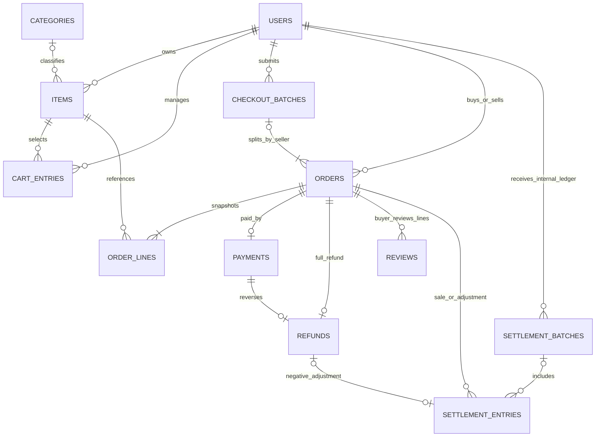
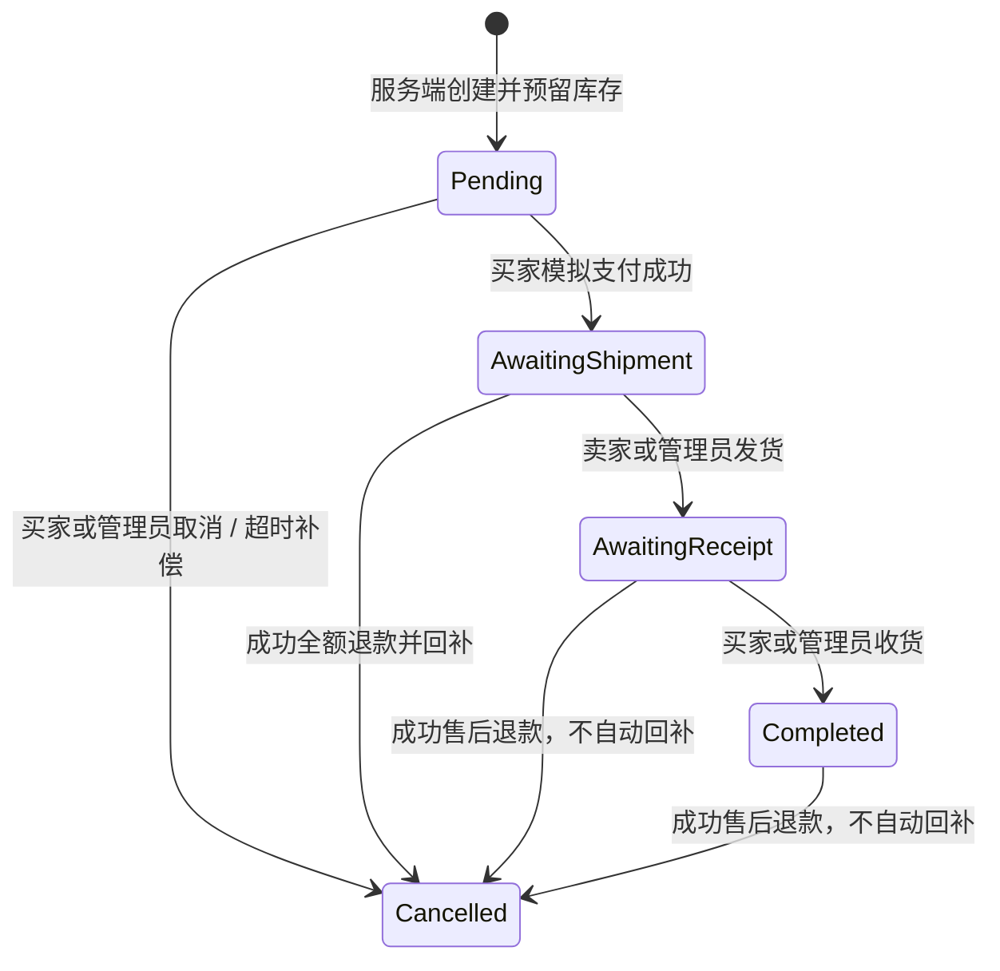

# 数据关系、权限与状态

金额整数分，时间UTC epoch秒；Java Clock可替换，所有业务时间由服务端生成。用户名ASCII且大小写敏感。USER可同时是其他订单买家与自己团购的卖家；禁止自购。ADMIN是管理能力，不是互斥卖家角色。

| 资源/操作 | 当前买家 | 对应发起人/卖家 | ADMIN | 无关普通用户 |
| --- | --- | --- | --- | --- |
| 用户私密资料 | 本人 | 仅本人 | 可管理 | 403 |
| 角色/封禁、用户列表、统计、审计、OpenAPI/Actuator | 无 | 无 | 允许；不能改自己角色 | 403 |
| 商品读取/搜索 | 允许 | 允许 | 允许 | 允许（均须登录） |
| 商品管理 | 无 | 本人商品 | 允许 | 403 |
| 购物车/结算批次 | 本人 | 只能看自己的购物车 | 可读对应批次；不能伪造结算买家 | 403 |
| 订单查询 | 自己买的 | 自己卖的；未付地址隐藏 | 全部 | 403；列表过滤不绕范围 |
| 模拟支付 | 本人 | 无 | 不能代付 | 403 |
| 发货 | 无 | 允许 | 允许 | 403 |
| 收货 | 允许 | 无 | 允许 | 403 |
| 取消未支付 | 允许 | 无 | 允许 | 403 |
| 取消已付待发货 | 申请售后 | 退款成功后关闭 | 同卖家 | 403 |
| 申请退款/评价 | 本人，满足状态 | 无 | 不代买家申请/评价 | 403 |
| 审核/重试退款 | 无 | 允许 | 允许 | 403 |
| 内部结算 | 账号自己作为卖家 | 自己账目 | 可选择卖家 | 403 |

私密地址仅买家/ADMIN及付款后履约卖家可见；商品/评价/统计不包含用户密码、哈希或地址。权限在服务层和Security共同实施。封禁及改密/角色变更使旧令牌失效；交易记录保留，需要ADMIN处理被封禁账号的待履约事务。

ORDERS保留第一明细摘要兼容旧API，事实金额来自不可变ORDER_LINES；PAYMENTS/REFUNDS每order唯一；SALE以generated sale_order_id唯一，REFUND以refund_id唯一。未分批的结算调整batch_id可空。CHANNEL_EVENTS按kind/eventId唯一并存参数摘要；SIMULATOR_OPERATIONS保持模拟渠道重试结果；BLACKLIST保存随机jti吊销；AUDIT_EVENTS无用户外键以记录失败/系统动作，只存哈希标识。FINANCE_MUTEX单行串行账务变更，课程规模下优先可验证一致性。

订单数值状态0/1/2/3/-1；退款是独立状态REQUESTED→REJECTED或APPROVED→SUCCEEDED/FAILED，FAILED可重试。处理中禁止发货/收货。重复操作先检查身份再检查原状态，在目标状态的允许重试保持原结果；旧动作跨过后续状态409。待付取消/超时仅释放一次，支付和取消锁住相同商品/订单；所有退款/取消/结算先账务锁，避免FK隐式锁与结算反向取锁。未发货退款回补一次；已发货不能自动把未回仓商品再出售。

账务核对：grossPaidAmount=成功支付累计；refundAmount=成功退款累计；netPaidAmount=前两者之差。完成未退款订单可生成唯一SALE，随后退款产生负REFUND调整；内部结算不改变支付净额。历史已付无凭据单独计数且禁止自动结算/退款。退款不是删除交易，已结算后退款可导致下一批负数。真实晚到支付资金补偿、部分退款与退货物流尚未实现。
